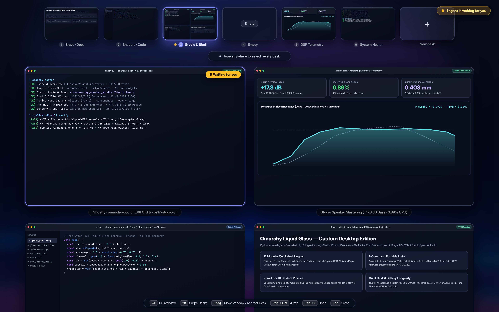
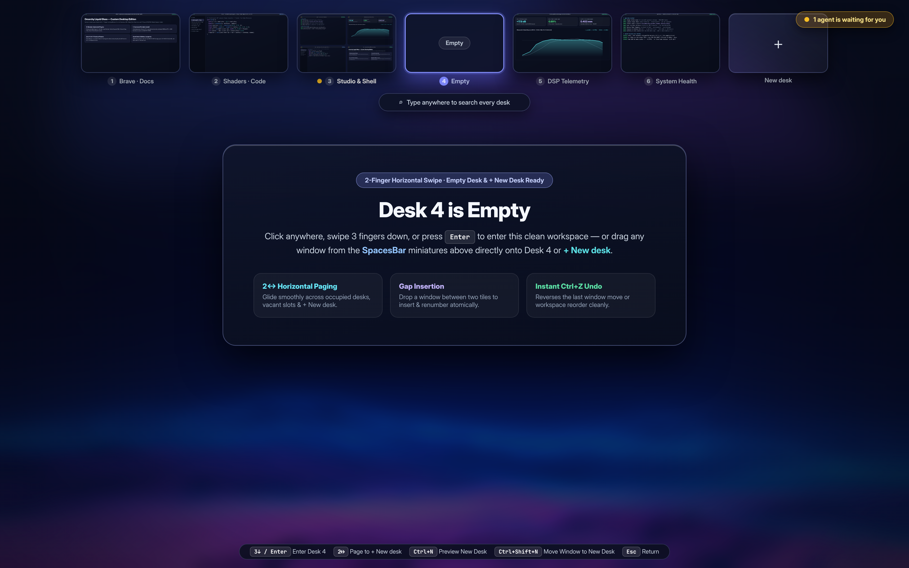

# omarchy-overview

A native **macOS Mission Control–class workspace & window overview** built in pure **Qt6 QML + Quickshell** and **Hyprland Lua** for [Omarchy Linux](https://omarchy.org).

Unlike static grid popups or shell-forking scripts, `omarchy-overview` tracks your fingers 1:1 through Hyprland's compositor event socket (`socket2`) with zero process forks per gesture, hands lift-off velocity into a critically damped spring, and executes workspace reorders and window moves atomically inside Hyprland's Lua runtime with full rollback and `Ctrl+Z` undo.

<p align="center">
  <a href="assets/overview-hero.png"></a>
</p>

## Highlights

- **1:1 Live Finger Tracking** — `hypr/overview.lua` converts libinput touchpad deltas into physical millimetres of travel and streams coalesced progress events (`ovg,b|u|e`) directly over Hyprland's `socket2` with zero process spawns. At lift-off, finger velocity hands off seamlessly into an analytic critically damped spring (`Gesture.js`).
- **Drag-and-Drop Windows & Desks** — Drag any window card onto a desk miniature, onto `+ New desk`, or into a gap between two desks to insert a fresh workspace. Drag desk tiles in `SpacesBar` to reorder workspaces live with instant position preview and atomic renumbering (`ops/ovops.lua`) plus `Ctrl+Z` undo.
- **Empty Desks & Horizontal Swipe to `+ New desk`** — Matches the bar's full workspace run (rendering quiet `Empty` pills on vacant slots). Swipe horizontally with two fingers inside the overview to page smoothly across occupied desks, empty desks, and straight onto `+ New desk` — then click, swipe down, or press `Enter` to enter it.
- **Instant Cross-Desk Search** — Simply start typing while the overview is open to filter every window across all desks by title, app, or desk number, ranked by prefix match and agent status.
- **Zero Idle Overhead & Live Theme Sync** — Stays resident as a 1×1 transparent pass-through surface when closed (0 timers, 0 forks, 0 GPU captures), enforces a 24-capture budget with calm single-frame staggered refreshes when open, and follows Omarchy's live `colors.toml` and wallpaper automatically.

<p align="center">
  <a href="assets/overview-empty-desk.png"></a>
</p>

## Architecture

```text
Touchpad 3/4-finger vertical swipe
        │
        ▼
hypr/overview.lua (Hyprland Lua provider)
  └─ Converts libinput accel deltas → physical mm (libinput curve LUT)
  └─ Emits custom>>ovg,{b,u,e} on socket2 (0 forks; auto-fallback to oneshot)
        │
        ▼
backends/HyprlandBackend.qml  ◀── swap for ──▶  backends/MockBackend.qml
  └─ Reads Quickshell Hyprland model + ScreencopyView (≤ 24 captures)
  └─ Dispatches atomic workspace ops via ops/ovops.lua (temp IDs + rollback)
        │
        ▼
Scene.qml (Pure QML, 1 FrameAnimation clock)
  ├── SpacesBar.qml + DeskTile.qml     Liquid Glass desk strip & miniatures
  ├── WindowCard.qml + rounded.frag    Justified rows (Layout.js) & SDF rounding
  ├── DragController.qml               Pointer + keyboard drag & gap insertion
  └── ResultPill.qml                   Operation status & one-click Undo
```

## Gesture & Keyboard Reference

| Input | Action |
|---|---|
| **3- or 4-finger swipe up** | Track open 1:1 under fingers; velocity/threshold commits open |
| **3- or 4-finger swipe down** | Track close 1:1 (enters viewed desk if switched; otherwise returns) |
| **2-finger horizontal swipe** | Page smoothly across desks, empty slots, and `+ New desk` |
| **Drag window → desk / gap / `+`** | Move window to desk, insert new desk between two desks, or open new desk |
| **Drag desk tile horizontally** | Reorder workspaces atomically (drop off strip to cancel) |
| **Type anywhere** | Live cross-desk search (`Esc` clears query, then closes) |
| **`Arrow keys` / `Tab` / `Ctrl+1..9`** | Navigate cards, cycle desks, or jump to desk `N` |
| **`Space` → `Arrows` → `Enter`** | Keyboard-only window lift, aim, and drop |
| **`Ctrl+Shift+Left/Right` / `1..9`** | Move selected window to adjacent or numbered desk |
| **`Alt+Shift+Left/Right`** | Reorder viewed desk left or right |
| **`Ctrl+N` / `Ctrl+Shift+N`** | Preview `+ New desk` / move selected window to new desk |
| **`Ctrl+Z`** | Undo last window move or desk reorder |
| **`Ctrl+W` / `Delete`** | Close selected window |

## Quick Install

### Portable Installer

```bash
git clone https://github.com/akshaybapat6365/omarchy-overview.git
cd omarchy-overview
./install.sh --systemd
```

Options:
- `--prefix DIR` — Custom Quickshell config target (default: `~/.config/quickshell/overview`)
- `--hypr-dir DIR` — Custom Hyprland config target (default: `~/.config/hypr`)
- `--wire-hypr` — Appends an idempotent `hypr/overview.lua` loader & `no_anim` layer rule to `~/.config/hypr/hyprland.lua` (creates a timestamped `.bak` first)
- `--systemd` — Installs `~/.config/systemd/user/omarchy-overview.service`

Enable the user service (or add `hl.exec_once("qs -c overview")` to `~/.config/hypr/autostart.lua`):

```bash
systemctl --user enable --now omarchy-overview.service
qs ipc -c overview call overview toggle
```

### Arch Linux (`PKGBUILD`)

```bash
makepkg -si
omarchy-overview-setup
systemctl --user enable --now omarchy-overview.service
```

### Uninstall

```bash
./uninstall.sh
```

## Test Suite

`omarchy-overview` ships with offline Lua, QML, and static lint suites that run headlessly without touching your compositor:

```bash
# Static checks (Qt 6 qmllint, Node JS syntax, Lua 5.5 syntax)
./tests/lint.sh

# Lua 5.5 tests (gesture stream curve, atomic reorder/insert rollback, A1 fallback)
lua tests/lua/run.lua

# Offscreen Qt6 QML tests (physics, layout, ops validation, interactions, empty desks)
for t in tests/ops/tst_ops.qml tests/qml/tst_*.qml; do
  QT_QPA_PLATFORM=offscreen /usr/lib/qt6/bin/qmltestrunner -platform offscreen -input "$t"
done
```

## License

[MIT](LICENSE) © 2026 Akshay Bapat
